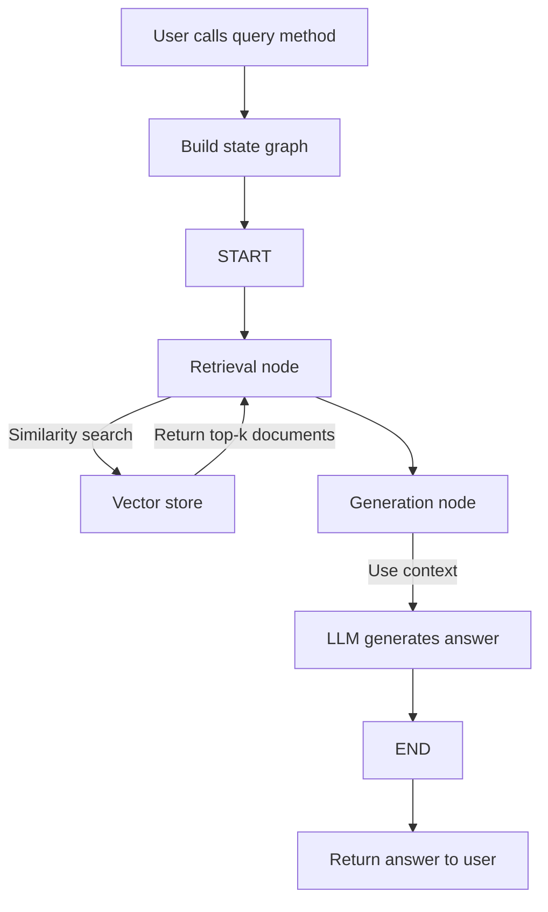
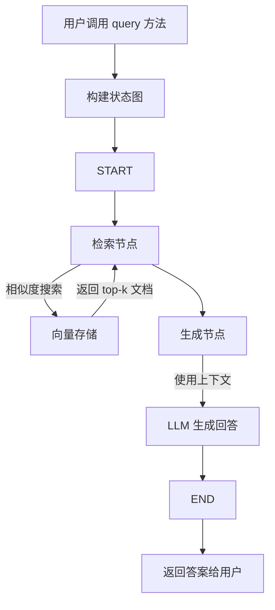

# RAG-in-LangGraph

[中文版本](#chinese-version)

## Project Description

This is a RAG (Retrieval Augmented Generation) project based on LangGraph. **It aims to reduce the barrier to entry for RAG, making it ready to use.**

This project includes retrieval augmentation, allowing users to chat with uploaded PDFs, achieving a chatpdf function. By combining retrieval and generation models, it provides more accurate and information-rich answers.

Achieve RAG augmentation with just a few lines of code:

```python
from dotenv import load_dotenv
load_dotenv(".env")

from rag_tools import RAGTool

rag_tool = RAGTool()
file_path = "README.pdf"
rag_tool.load_pdf(file_path)

message = rag_tool.query("Please design 3 multiple-choice questions to test my understanding of the material.")
print(message.content)
```

## Installation

1. Clone the project locally:

   ```bash
   git clone https://github.com/kuhung/RAG-in-LangGraph.git
   cd RAG-in-LangGraph
   ```
2. Install `uv` (if not already installed):

   ```bash
   curl -LsSf https://astral.sh/uv/install.sh | sh
   # Or install via pipx: pipx install uv
   ```
3. Install Python dependencies:

   ```bash
   uv sync
   ```
4. Configure environment variables:
   Copy the `.env.example` file and rename it to `.env`, then fill in API keys and other information according to your actual situation.

## Usage

Currently, the project includes `rag_tools.py` for defining RAG-related tool functions. The specific workflow is as follows:



The `rag.ipynb` file demonstrates the process. Only a few lines of code are needed to call the complete RAG lifecycle:

```python
from dotenv import load_dotenv
load_dotenv(".env")

from rag_tools import RAGTool

rag_tool = RAGTool()
file_path = "README.pdf"
rag_tool.load_pdf(file_path)

message = rag_tool.query("Please design 3 multiple-choice questions to test my understanding of the material.")
print(message.content)
```

## Contact

- **author**: kuhung
- **Email**: hi@kuhung.me

## License

This project is licensed under the MIT License - see the [LICENSE](LICENSE) file for details.

---

# RAG-in-LangGraph

## <a id="chinese-version"></a>项目描述

这是一个基于 LangGraph 实现 RAG (Retrieval Augmented Generation) 的项目。**它旨在减少关于RAG的上手成本，拿来就能用。**

该项目包含检索增强，用户可与上传的PDF进行对话，实现 chatpdf 功能。通过结合检索和生成模型，提供更准确和信息丰富的回答。

只需几行代码，即可调用实现RAG增强

```python
from dotenv import load_dotenv
load_dotenv(".env")

from rag_tools import RAGTool

rag_tool = RAGTool()
file_path = "README.pdf"
rag_tool.load_pdf(file_path)

message = rag_tool.query("帮我设计3个选择题，考验我对资料的掌握情况")
print(message.content)
```

## 安装

1. 克隆项目到本地：

   ```bash
   git clone https://github.com/kuhung/RAG-in-LangGraph.git
   cd RAG-in-LangGraph
   ```
2. 安装 `uv` (如果尚未安装)：

   ```bash
   curl -LsSf https://astral.sh/uv/install.sh | sh
   # 或者通过 pipx 安装：pipx install uv
   ```
3. 安装 Python 依赖：

   ```bash
   uv sync
   ```
4. 配置环境变量：
   复制 `.env.example` 文件并重命名为 `.env`，然后根据您的实际情况填写 API 密钥等信息。

## 说明

目前项目包含 `rag_tools.py` 文件，用于定义 RAG 相关的工具函数。具体工作流程如下：



文件 `rag.ipynb`为演示流程，只需要下面的几行代码，即可调用完整的RAG生命周期：

```python
from dotenv import load_dotenv
load_dotenv(".env")

from rag_tools import RAGTool

rag_tool = RAGTool()
file_path = "README.pdf"
rag_tool.load_pdf(file_path)

message = rag_tool.query("帮我设计3个选择题，考验我对资料的掌握情况")
print(message.content)
```

## 联系方式

- **作者**: kuhung
- **邮箱**: hi@kuhung.me


## 许可证

本项目使用 MIT 许可证 - 更多详情请参阅 [LICENSE](LICENSE) 文件。